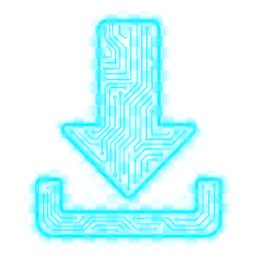
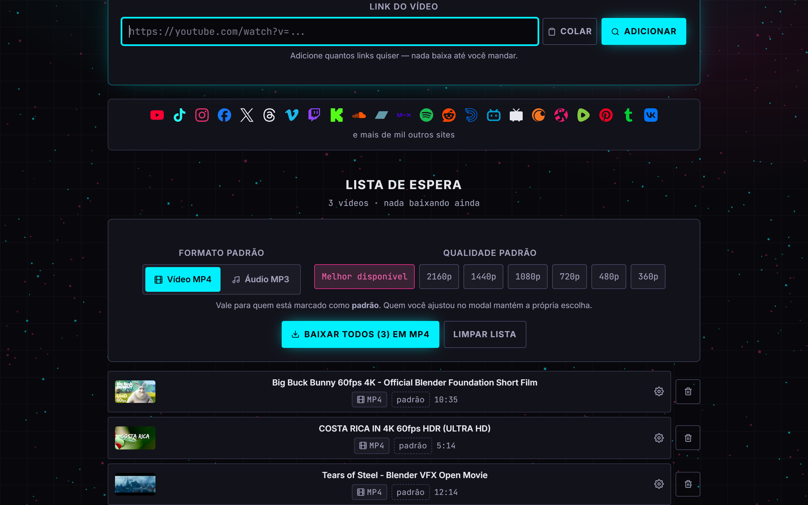
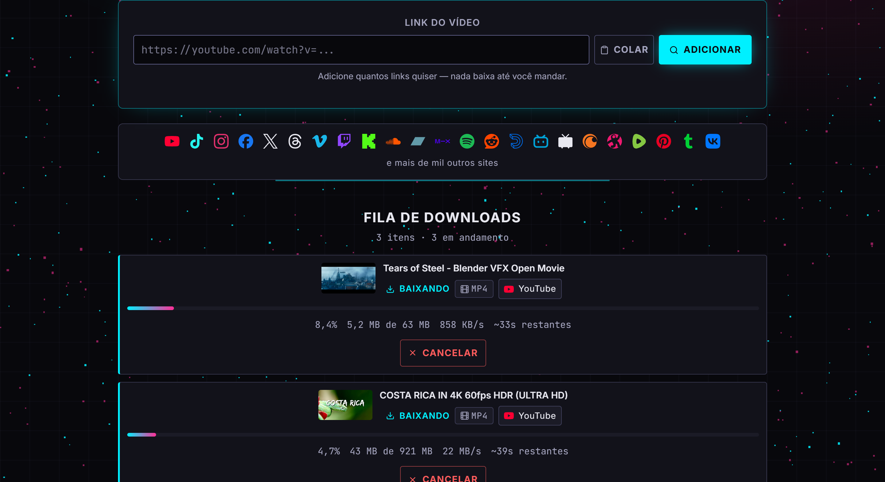
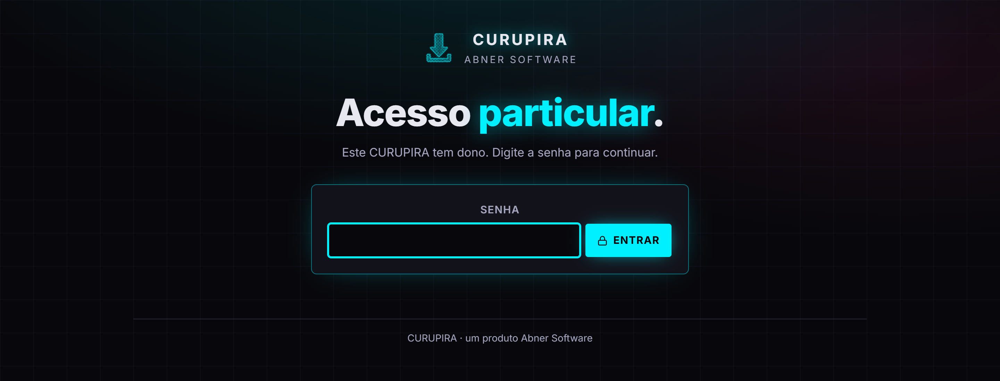

<div align="center">



# CURUPIRA

### Baixe vídeos e músicas **sem assinatura**.

Cole o link. Escolha MP4 ou MP3. Pronto.<br/>
Uma estação de extração de mídia com cara de nave e alma de ferramenta — feita para quem
não aceita pagar mensalidade para guardar o que gosta.

<br/>


<br/>


</div>

<br/>

## Mil sites. Um campo de texto.

YouTube, TikTok, Instagram, X, Vimeo, Twitch, SoundCloud, Reddit, Bilibili, Pinterest — e mais
de mil outros. O CURUPIRA reconhece a plataforma no instante em que o link chega, mostra a
capa, o título e a duração, e só baixa quando **você** mandar.

Até link do **Spotify** funciona: o CURUPIRA lê a faixa, encontra a mesma música numa fonte
aberta e mostra a correspondência antes de baixar qualquer coisa. Nada escondido, nada no
escuro.

<br/>

<table>
<tr>
<td width="50%" valign="top">

### 🎬 Até 4K, até 60 fps
Do 360p ao 2160p, vídeo e áudio mesclados num MP4 que abre em qualquer lugar.

### 🎧 MP3 na melhor qualidade
Só a música, extraída direto da melhor faixa de áudio disponível.

### 📋 Lista de espera
Junte dez, vinte links. Ajuste um por um ou defina um padrão para todos — e dispare o lote
num clique.

</td>
<td width="50%" valign="top">

### ⚡ Progresso ao vivo
Percentual, velocidade, tamanho e tempo restante atualizando em tempo real, sem recarregar
nada.

### 🛡️ Blindado por padrão
Nenhum link passa por shell, nenhuma flag vem do navegador, link para rede interna é
recusado na porta. E, no servidor, uma senha guarda a entrada.

### 📱 Do bolso ao ultrawide
Pensado primeiro para o celular. Teclado, leitor de tela e foco visível em cada detalhe.

</td>
</tr>
</table>

<br/>

<div align="center">



<sub><b>A lista de espera</b> — nada baixa até você decidir.</sub>

<br/><br/>



<sub><b>A fila</b> — três downloads em paralelo, cada byte contado.</sub>

<br/><br/>

<table>
<tr>
<td width="36%" align="center" valign="top">
<br/>
<sub><b>No celular</b>, inteiro.</sub>
</td>
<td width="64%" align="center" valign="top">
<br/>
<sub><b>Acesso particular</b> — publicado na web, só entra quem tem a senha.</sub>
</td>
</tr>
</table>

</div>

<br/>

## Feito com capricho

- **Um universo vivo ao fundo.** Um campo de partículas em three.js que acelera quando há
  download rodando e descansa quando a fila esvazia — e respeita quem pediu menos movimento.
- **Honesto até no percentual.** A barra nunca mostra 100% antes do arquivo existir. Erros
  chegam em português de gente, não em stack trace.
- **Leve no fio.** Progresso por Server-Sent Events: fila parada não gera um byte de tráfego.
- **Pronto para servidor.** Imagem Docker enxuta, sem root, com yt-dlp que se atualiza sozinho
  a cada reinício e faxina automática dos arquivos já entregues.
- **Como o guardião da mata**, o CURUPIRA vai, volta e não deixa rastro: no servidor, o que
  você baixou some depois de algumas horas.

<br/>

## Em um minuto

```bash
git clone https://github.com/AbnerSantosss/curupira.git && cd curupira
CURUPIRA_ACCESS_KEY="uma-frase-longa" docker compose up -d --build
```

Abra `http://127.0.0.1:3055` — ou aponte seu túnel para lá.

Prefere rodar na sua máquina? `npm install && npm run dev` (com yt-dlp e ffmpeg instalados).
No Windows, dois cliques em `launcher/CURUPIRA.cmd` fazem tudo.

> Quer entender como funciona por dentro? **[docs/ARQUITETURA.md](docs/ARQUITETURA.md)** ·
> O contrato visual está em **[DESIGN.md](DESIGN.md)**.

<br/>

---

<div align="center">

<sub>
Ferramenta de uso pessoal. Baixe apenas o que você tem direito de baixar — obras sob licença
aberta, material próprio ou o que os termos da plataforma permitirem.
</sub>

<br/><br/>

**CURUPIRA** · um produto **Abner Software**

</div>
